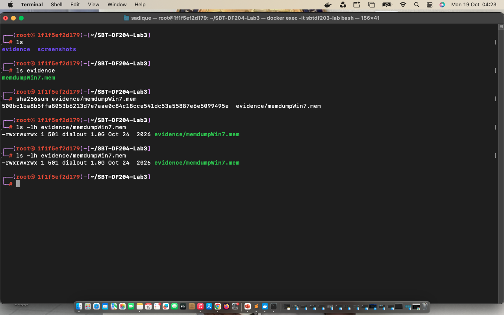
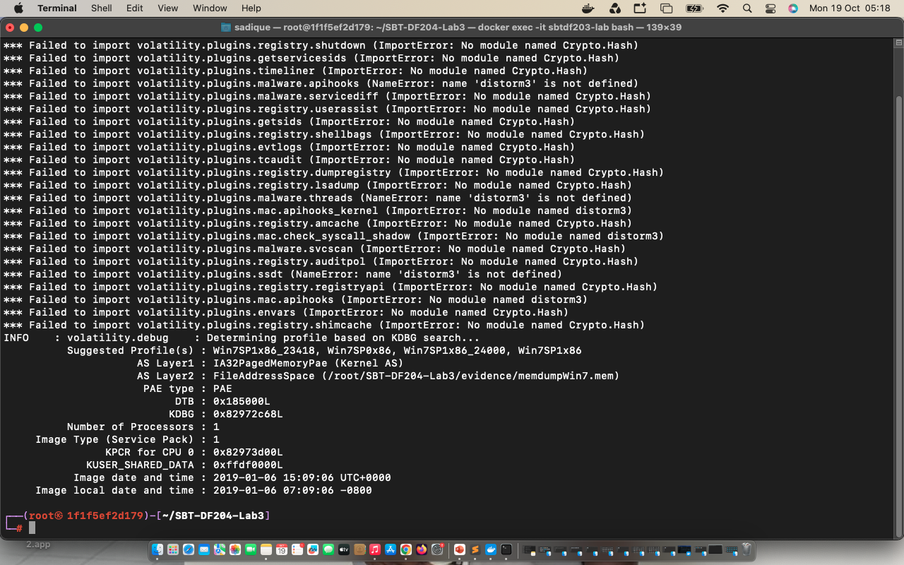
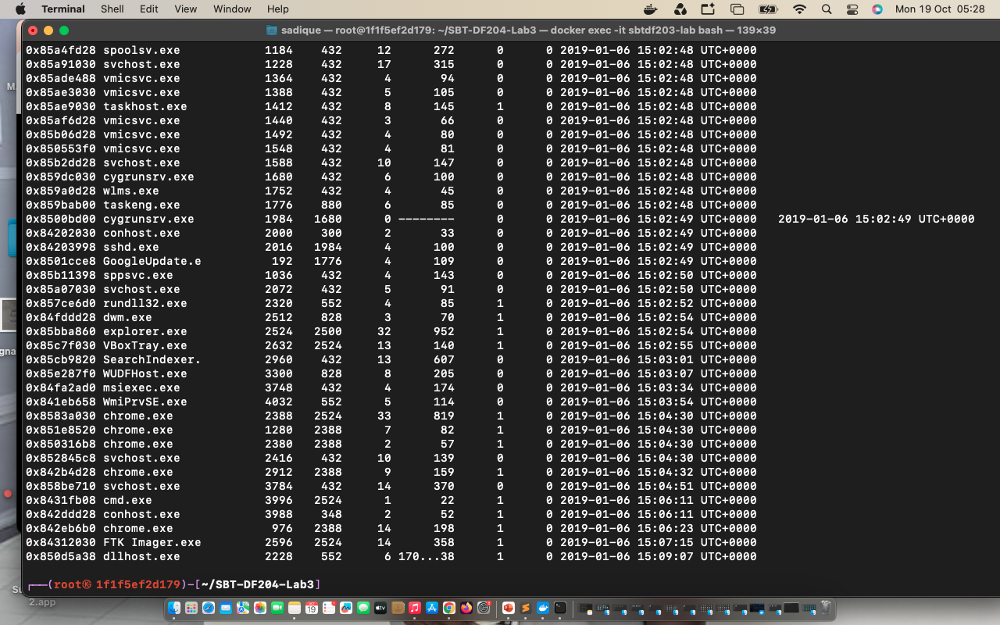
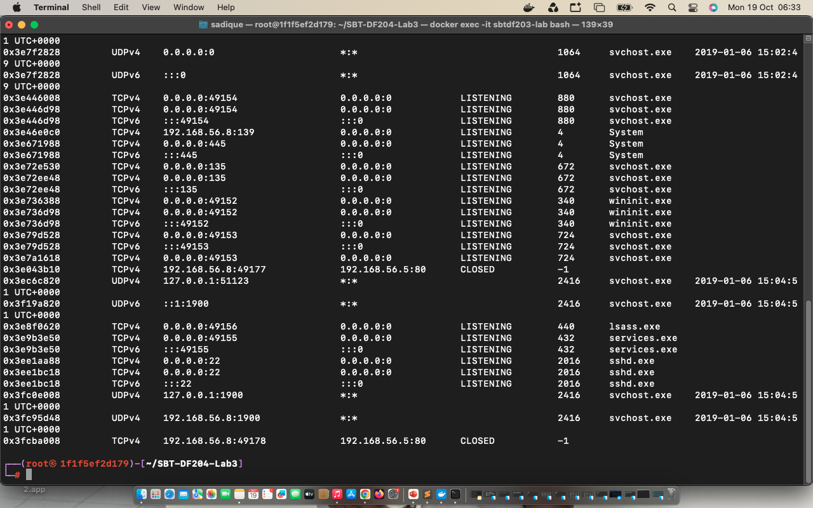

# Memory Forensics Investigation Report: SBT-DF204 Case Study 3

Analyst: Abubakari-Sadique Hamidu

Case ID: SBT-DF204-Lab3
OS Profile: Windows 7 Service Pack 1 (x86)
Evidence Image: memdumpWin7.zip
SHA-256 Checksum: 500bc1ba8b5ffa8053b6213d7e7aae0c84c18cce541dc53a55887e6e5099495e

# 1. Executive Summary
This investigation analyzed a Windows 7 memory dump to identify unauthorized activity and potential data exfiltration. Analysis using Volatility 2 successfully reconstructed process trees, network endpoints, and command prompt histories. Evidence confirmed that a user navigated to the Downloads directory during an active command shell session and copied a sensitive file named secret_file.docx to an external drive designated as F:.

# 2. Evidence Verification & Image Profile (E01 & E02)
Cryptographic hashing verified evidence integrity prior to performing analysis. Determining the precise operating system profile ensured accurate plugin execution.
E01 - Evidence Integrity: Verified via SHA-256 hash 500bc1ba8b5ffa8053b6213d7e7aae0c84c18cce541dc53a55887e6e5099495e.
E02 - OS Profile: Identified as Win7SP1x86 with a system image timestamp of 2019-01-06 15:09:06 UTC.

Figure 1: Cryptographic hash verification of the memory dump.

*Figure 2: Volatility imageinfo output identifying the Win7SP1x86 profile.*

## 3. Process Analysis (E03)
Executing pslist exposed active processes associated with forensic tools, command shells, and browser activity.
Key Processes Identified:
  * cmd.exe (PID: 3996, PPID: 2524): Spawned under explorer.exe at 2019-01-06 15:06:11 UTC.
  * FTK Imager.exe (PID: 2596, PPID: 2524): Active during evidence handling at 2019-01-06 15:07:15 UTC.
  * chrome.exe (PIDs: 2388, 1280, 2380, 2912, 976): Active web sessions.

Figure 3: Volatility pslist output highlighting cmd.exe and FTK Imager.*

# 4. Network Artifacts & Analysis (E04)
Profile constraints prevented executing legacy connscan on Windows 7. Running netscan enabled parsing active and closed network sockets.

Network Findings:
  * Active local interface IP identified as 192.168.56.8.
  * Documented local service listeners and closed HTTP connections (192.168.56.8:49177 to 192.168.56.5:80).

Figure 4: Volatility netscan output showing network sockets and active interfaces.

# 5. Command History & Exfiltration Reconstruction (E05)
Running consoles and cmdscan extracted the complete command history for cmd.exe (PID 3996), revealing explicit file transfer activity.

C:\Users\IEUser>ipconfig
C:\Users\IEUser>cd Downloads
C:\Users\IEUser\Downloads>copy secret_file.docx F:
        1 file(s) copied.

Figure 5: Volatility consoles output displaying file transfer execution.*

# 6. Challenges and Technical Exceptions

1. Python 2 Deposition & Missing Development Headers:** Building native C-extension libraries like pycrypto and distorm3 via pip failed due to missing development headers and deprecated build hooks. Resolving runtime dependencies directly within the container environment bypassed manual compilation.
2. Profile-Specific Plugin Restrictions: Running connscan produced a profile error because the module targets legacy Windows XP/2003 architectures. Transitioning to netscan enabled successful network socket extraction on Windows 7.
3. Repository Git Push Limits: Pushing raw 1.0 GB binary dumps caused network timeouts and remote size rejection. Compressing evidence files into a ZIP archive stabilized repository synchronization.

7. Conclusion

Artifacts extracted from memdumpWin7.mem demonstrate that the user accessed C:\Users\IEUser\Downloads and copied secret_file.docx to target drive F:. Forensic findings and command histories stand fully validated.
